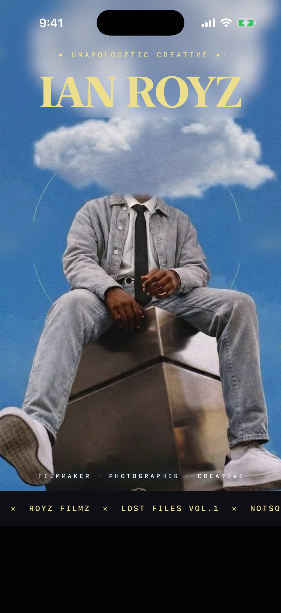
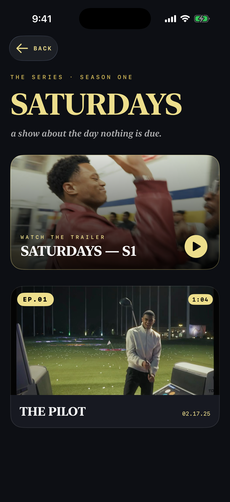
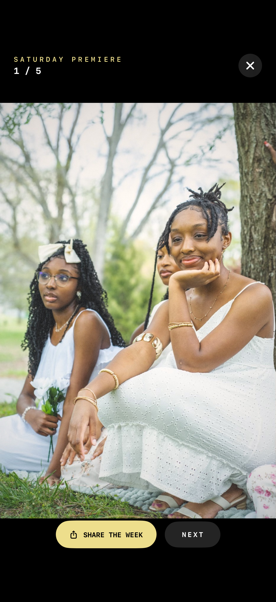
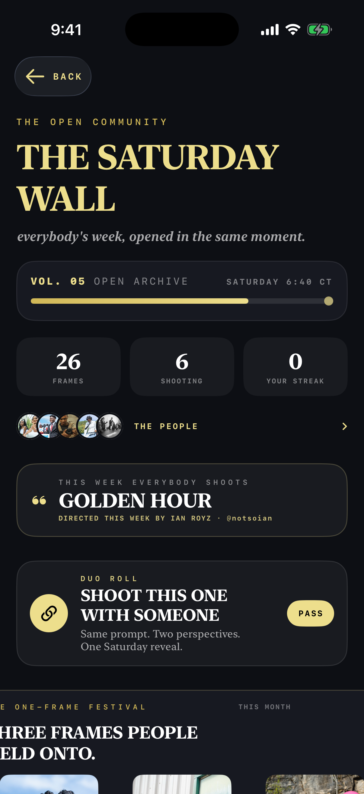
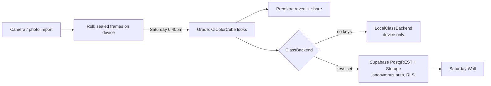

# IAN ROYZ

The personal-brand iOS app for filmmaker and photographer Ian Royz: his films and photo series in one place, plus THE ROLL, a disposable camera whose frames stay sealed until Saturday evening and then develop on a shared community wall.

<p>
  
  
  
  
</p>

## Why

Most creator apps are a feed of things already on Instagram, and they get deleted. This one is built around a feature that is still worth using with the creator's name taken off it: a weekly camera ritual where everyone's photos develop in the same minute. The portfolio rooms around it carry the brand.

## Features

- **Film rooms**: SATURDAYS (an episodic series), Lost Files, and Motion pieces, with an inline player that locks to landscape only while a film is playing.
- **Shoots**: photo series in horizontal galleries, with share links on every still.
- **THE ROLL**: shoot or import frames that stay sealed until Saturday 6:40pm. On reveal they develop with one of five hand-tuned Core Image grades (Daydream, Can't Kill the South, Golden Hour, Lost Files, Midnight) and play back as a "Saturday premiere".
- **The Saturday Wall**: every roll develops at the same moment and lands on one shared wall that stacks a volume per Saturday. Handles and avatars, KEEP (instead of likes), notes, roster, streaks, a weekly prompt, and duo rolls.
- **Moderation built in**: rules gate, report, block, own-delete, and automatic takedown after three reports (App Review guideline 1.2).
- **Remote copy**: `Live.swift` pulls an optional JSON feed so headlines and drops can change without an app update.
- "Daydream" design: sky-blue gradient, butter-gold serif type, dark ink rooms for film.

## How it works



There is no SDK dependency. `ClassRemote.swift` talks to Supabase with plain `URLSession` calls (PostgREST for six tables, Storage for one public bucket) under an anonymous auth session. Every table is protected by row-level security tied to that anonymous user; the schema and policies are in `supabase/`. If no Supabase credentials are configured, the app falls back to a device-only backend and still works.

## Tech stack

- Swift 5, SwiftUI, iOS 17+ (iPhone and iPad), Xcode 16 synchronized folder groups
- AVFoundation (player, camera), Core Image (grades), PhotosUI
- Supabase (Postgres, RLS, Storage, anonymous auth) over raw REST
- `_tools/`: AVFoundation scripts used to re-encode the bundled films to HEVC and probe them

## Getting started

Requirements: macOS with Xcode 16 or newer.

1. Open the project:
   ```sh
   open IanRoyz.xcodeproj
   ```
2. Pick the **IanRoyz** scheme and an iPhone simulator, then press **Cmd+R**. Signing is left without a team; choose your own under *Signing & Capabilities* to run on a device.
3. Optional, to use a live Saturday Wall:
   ```sh
   cp Config/Secrets.example.xcconfig Config/Secrets.xcconfig
   ```
   Fill in `SUPABASE_HOST` (host only, such as `abcd.supabase.co`) and `SUPABASE_ANON_KEY` (the publishable key), apply `supabase/class-roll.sql` and `supabase/global-community.sql` in the Supabase SQL editor, create a public `wall` storage bucket, and enable anonymous sign-ins.

Command-line build:

```sh
xcodebuild -project IanRoyz.xcodeproj -scheme IanRoyz -sdk iphonesimulator \
  -destination 'platform=iOS Simulator,name=iPhone 17 Pro' build
```

**Media note:** the film files (`IanRoyz/Resources/*.mp4`, about 120 MB) are not in this repository. The app builds and runs without them; film rooms show their poster frames but will not play.

### Debug launch arguments

| Argument | Effect |
|---|---|
| `ENTERED` | skip the landing video |
| `-ROOM <name>` | open a room: `motion`, `saturdays`, `rotation`, `roll`, `class`, `lost`, `shoots` |
| `-SEEDROLL <n>` | put *n* bundled photos into THE ROLL (the simulator has no camera) |
| `-DEVELOPNOW` | ignore the Saturday gate and develop immediately |
| `-SEEDCLASS <n>` | fill the wall with *n* Saturdays of demo frames from invented classmates |
| `-CLASSSHEET <s>` | open a wall sheet directly: `drop`, `frame`, `roster` |

```sh
xcrun simctl launch booted com.ianroyz.app -ROOM roll ENTERED -SEEDROLL 5 -DEVELOPNOW
```

## Project structure

```
IanRoyz/
  IanRoyzApp.swift     App entry, orientation lock
  Media.swift          Content catalog (films, series, shoots, links)
  Roll.swift, Camera.swift, Grade.swift   THE ROLL: capture, sealing, grades
  Class.swift, ClassRemote.swift          Saturday Wall models + Supabase backend
  Live.swift           Remote copy feed
  Views/               Home, landing, film rooms, roll, wall, onboarding
  Resources/           Posters and photo series (HEIC)
Config/                xcconfig base + Secrets.example.xcconfig
supabase/              Schema, RLS policies, storage rules
_tools/                Video re-encode and probe scripts
docs/screenshots/      Simulator screenshots
```

## Status

Version 1.0 is [live on the App Store](https://apps.apple.com/us/app/ian-royz/id6788837187). Screenshots above were captured from this repository's build in the iOS simulator; the wall screenshot uses the `-SEEDCLASS` demo data.

Built by [Ian Royes](https://github.com/ianroyes-sys)
